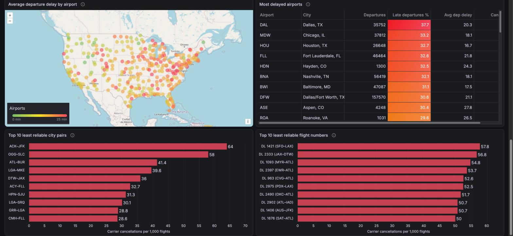
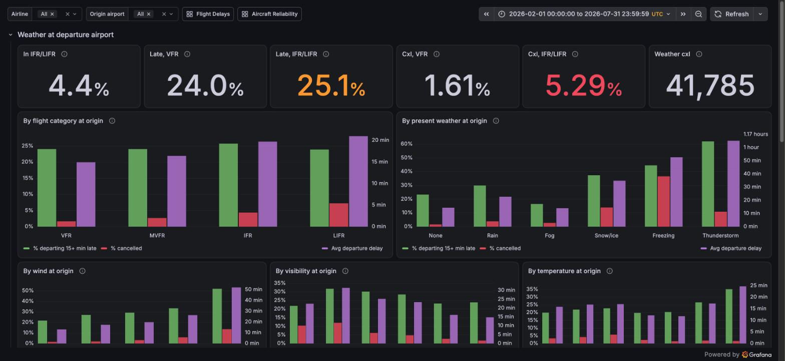
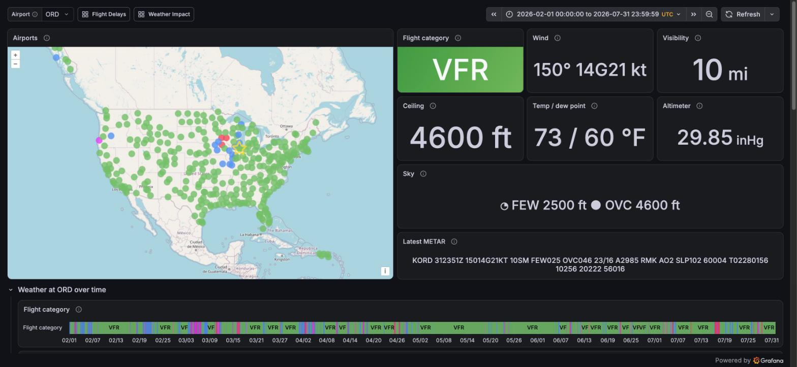
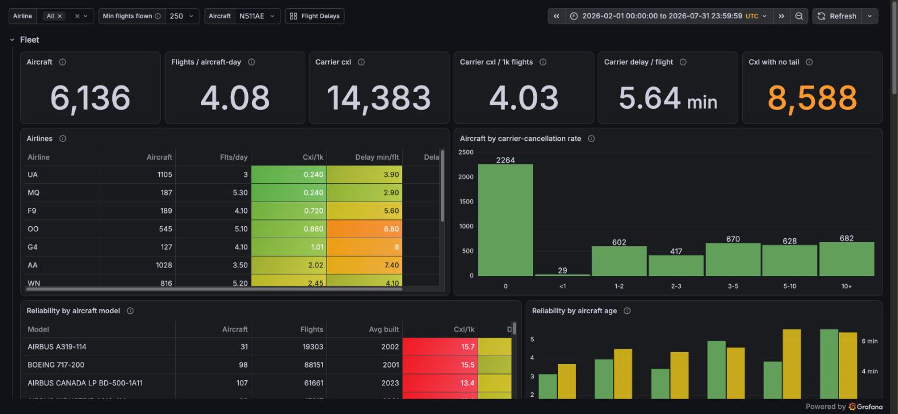
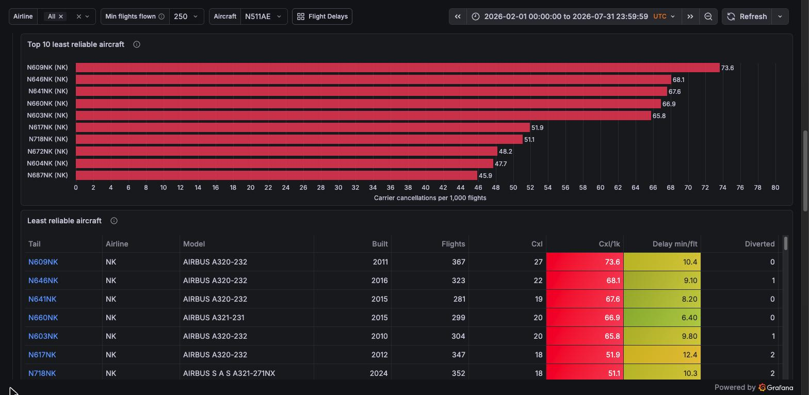
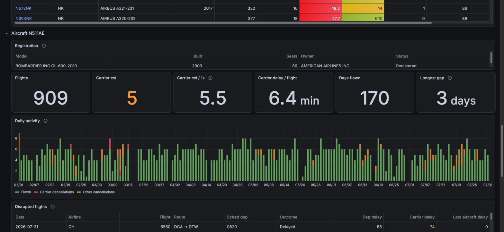

# bigquery-faadata-demo
A Google BigQuery / Grafana application that uses publicly available FAA flight and weather data.

* **BigQuery**: a dataset (default `faa`) in any Google Cloud project you can run queries in
* **Loader**: Java 21 / Maven, the Google Cloud BigQuery client; scripts use the `bq` CLI
* **Dashboards**: Grafana with the `grafana-bigquery-datasource` plugin

This is a port of [clickhouse-faadata-demo](https://github.com/srmadscience/clickhouse-faadata-demo):
the same data, tables and dashboards, on BigQuery instead of ClickHouse. The ten years of
data from 2016 take about 5 GB of downloads. [ClickHouse vs BigQuery](docs/clickhouse-vs-bigquery.md)
goes through what changed in the code, and why.

**Status.** Every script, the Java loader and all 82 dashboard queries have been run
against BigQuery, including a full ten-year load (2016-01 to 2026-07: 68.4 million flights,
42.2 million weather reports). Not yet tested: `grafana-provision.sh` and the dashboards
in a running Grafana, and the Google Cloud VM (`gcp/create-vm.sh`, `install-server.sh`).

## Data

| Table | Source | Grain |
|-------|--------|-------|
| `faa.ontime` | [BTS on-time performance](https://www.transtats.bts.gov/) | one row per scheduled flight; times are airport-local |
| `faa.stations` | [IEM](https://mesonet.agron.iastate.edu/) ASOS station metadata | one row per weather station, incl. time zone |
| `faa.weather` | [IEM ASOS](https://mesonet.agron.iastate.edu/request/download.phtml) observations | one row per METAR (roughly hourly), UTC |
| `faa.weather_load` | | staging for `load-weather.sh`: the last batch loaded |
| `faa.airports` | [OurAirports](https://ourairports.com/data/) | one row per airport worldwide: codes, names, coordinates |
| `faa.airport_station` (view) | | BTS airport code → IEM station and time zone |
| `faa.registry_master`, `faa.registry_dereg`, `faa.registry_models` | [FAA aircraft registry](https://www.faa.gov/licenses_certificates/aircraft_certification/aircraft_registry/releasable_aircraft_download) | registered and deregistered aircraft; make/model reference |
| `faa.aircraft` (view), `faa.aircraft_info` (snapshot) | | one row per tail number: model, year built, seats, owner, status |
| `faa.tail_day` | built from `ontime` | one row per aircraft per airline per day: flights, cancellations, carrier delay (for the Aircraft Reliability dashboard) |
| `faa.flight_weather` | built from `ontime` + `weather` | one row per flight with UTC schedule times and the weather (flight category, wind, visibility, present weather) at origin and destination |

To join flights to weather, go through `faa.airport_station`: `ontime.Origin = airport`,
`weather.station = station`. Station ids differ from BTS codes outside the lower 48
(FAI → PAFA, SJU → TJSJ), and `sql/35_airport_aliases.sql` covers re-coded airports
(PBI → DJT) and closed ones (ISN, Williston, closed 2019). Saipan (SPN) has no IEM station.

Flights join to aircraft on `ontime.tail = aircraft_info.tail` (99.9% of 2025 tail numbers
match; aircraft retired since come from the deregistration file). Owner street addresses
are never loaded, and owner names only for organisations, not individuals.

## Layout

    src/main/java/...      Loader: ping | schema | load (CSV / .gz / .zip as load jobs) | bench (query timing)
    sql/                   Table and view definitions, run in file-name order
    scripts/               Everything needed to rebuild the dataset and Grafana (below)
    gcp/                   Script that builds a complete demo server on Google Cloud (below)
    docs/                  How the code differs from the ClickHouse version; screenshots
    grafana/provisioning/  Datasource + dashboard provider config
    grafana/dashboards/    Exported dashboard JSON (committed)
    data/                  Downloaded data: NOT in git (see data/README.md)

## Reproducing the database

Needs bash, curl, python3, perl, Java 21 and Maven, the [Google Cloud CLI](https://cloud.google.com/sdk/docs/install)
(for `bq`), and a Google Cloud project with billing and the BigQuery API enabled, where you
can create datasets and run jobs (the BigQuery User and BigQuery Data Editor roles, or Owner).

    gcloud auth login                         # for bq
    gcloud auth application-default login     # for the Java loader
    cp bigquery.properties.example bigquery.properties   # set bigquery.project, dataset, location
    scripts/reproduce.sh 2025-01 2025-12

Both logins must be an account with those roles in the project; the application-default
one is easy to forget, and without it the loader fails with a permission error.
`bigquery.properties` is git-ignored. The `BIGQUERY_PROJECT`, `BIGQUERY_DATASET`,
`BIGQUERY_LOCATION` and `BIGQUERY_CREDENTIALS` environment variables override it. Instead of
your own login, `bigquery.credentials` can name a service-account key file, which both `bq`
and the loader then use.

The SQL and dashboards are written for a dataset called `faa`; with any other
`bigquery.dataset`, the scripts substitute its name as they run or install them, so several
copies can share a project.

`reproduce.sh` runs these steps in order. Each is safe to re-run, and can be run on its own:

| Script | Does |
|--------|------|
| `create-database.sh` | Creates the dataset and the tables and views from `sql/` |
| `fetch-flights.sh FROM TO` | Downloads BTS months (`YYYY-MM`) not already in `data/raw/flights/` |
| `load-flights.sh` | Loads them, each month's load job replacing that month's partition |
| `build-tail-day.sh` | Rebuilds `tail_day`; re-run after loading flights |
| `fetch-stations.sh` / `load-stations.sh` | Gets IEM stations and OurAirports; lists airports with no station |
| `fetch-weather.sh FROM TO` | Downloads IEM observations (years) for every airport in `faa.ontime` |
| `load-weather.sh` | Loads them, replacing any observations already loaded and dropping duplicates |
| `build-flight-weather.sh` | Rebuilds `flight_weather`; re-run after loading flights, stations or weather |
| `fetch-registry.sh` / `load-registry.sh` | Gets the FAA registry; replaces the registry tables and `aircraft_info` |

The fetch scripts download from the project's [data mirror](#data-mirror) first and go
to the original sources only for what it lacks, so a full rebuild takes minutes, not hours.

To add more data later, run `reproduce.sh` with a wider range: existing downloads are skipped.
New months come from BTS if the mirror doesn't have them yet. To bring the current year's
weather, the station list or the registry up to date, use `--refresh`:

    scripts/fetch-weather.sh --refresh 2026 2026
    scripts/fetch-stations.sh --refresh
    scripts/fetch-registry.sh --refresh

### How the data gets into BigQuery

* **Load jobs, not inserts.** The Java loader reads each CSV (plain, gzipped, or inside the
  BTS zip), matches its columns to the table's by name, and uploads the result, gzipped, as
  one BigQuery load job. Load jobs are free; BigQuery allows 1,500 a day per table, so a
  full reload of ten years of flights (127 jobs) can be repeated about ten times a day.
  `LOAD_JOBS` (default 8) sets how many run at once.
* **Months are partitions.** `ontime`, `tail_day` and `flight_weather` are partitioned by
  month. Each month of flights is loaded straight into its partition (`ontime$202506`),
  replacing it, so a reload never duplicates flights.
* **`tail` is computed by the loader.** BTS reports Allegiant's tail numbers without the
  `N`; the loader adds a normalised `tail` column, and `ontime` is clustered by it, so one
  aircraft's flights are read without scanning everyone else's.
* **Weather is merged.** Each year of observations is loaded into `weather_load`, then, in
  one transaction, replaces any rows in `weather` with the same station and time.
* **Flights meet weather in a window.** BigQuery has no ASOF JOIN, so `build-flight-weather.sh`
  puts flights and observations into one stream per station and day, and carries the latest
  observation forward onto each flight with `LAST_VALUE(... IGNORE NULLS)`. On June 2025,
  every one of the 611,545 matches agreed with a brute-force join.
* **Empty values.** As in the ClickHouse version, empty strings are `''`, never NULL, so the
  SQL can test `tail = ''`. Empty numbers are NULL; unlike the ClickHouse version, that
  includes the quoted empty times (`DepTime` etc.) of cancelled flights, which ClickHouse read as 0.
* **Personal data.** Owner street addresses are blanked before the registry files leave the
  machine, and so are the names of individual owners; only organisations' names are uploaded.

### Load times

Measured in October 2026 from an Apple M2 Mac (16 GB RAM) over a home connection, to the
`US` multi-region, starting from an empty dataset and an empty `data/raw/`, for 2016-01 to
2026-07 (`scripts/reproduce.sh --time ... 2016-01 2026-07`):

| Step | Time |
|------|-----:|
| `create-database.sh` (16 statements, one `bq` call each) | 32 s |
| `fetch-flights.sh` (127 monthly zips, about 3.3 GB, from the mirror) | 7 min 21 s |
| `load-flights.sh` (127 months, 68.4 million flights, 8 load jobs at a time) | 25 min 15 s |
| `build-tail-day.sh` (16.7 million aircraft-days) | 12 s |
| `fetch-stations.sh`, `load-stations.sh` | 21 s |
| `fetch-weather.sh` (11 years, about 1.6 GB, from the mirror) | 3 min 3 s |
| `load-weather.sh` (11 years, 42.2 million reports) | 35 min 58 s |
| `build-flight-weather.sh` (68.4 million flights) | 31 s |
| `fetch-registry.sh`, `load-registry.sh` | 1 min 27 s |
| **Total** | **1 h 14 min 40 s** |

An earlier run took 4 h 6 min by the clock, because the Mac went into idle sleep for
2 h 42 min of it; `reproduce.sh` now runs under `caffeinate` on macOS, so it can't, as
long as the lid stays open. Both runs are in `testresults_load.csv`.

The loader's time goes mostly into reading, converting and compressing the CSVs on the
client, and the upload; the build steps run entirely in BigQuery, and are fast even over
all ten years. To time a load from scratch, delete the dataset (`bq rm -r -f faa`)
and move the downloaded files out of `data/raw/`, then run:

    scripts/reproduce.sh --time "what changed since the last test" 2016-01 2026-07

This appends each step's time to `testresults_load.csv`, with the date, git commit,
BigQuery location and the comment, so runs can be compared.

### Costs

Loading is free. Storage is billed by size; the full dataset took 10 GB in ClickHouse,
and BigQuery bills uncompressed logical bytes by default, so expect several times that,
which is still a few dollars a month at most. Queries are billed by the bytes they read:
with on-demand pricing the first TiB a month is free, then about $6.25 per TiB. The
dashboards filter on the partitioning date and read only the columns they need, so a
panel's cost grows with its time range, not the size of the dataset; every query is billed
at least 10 MB per table it reads. A dry run (`bq query --dry_run`) shows what a query
would read. The build scripts read
the whole of `ontime` (and `weather`) each time they rebuild everything; give them months
(`scripts/build-flight-weather.sh 202606`) to rebuild just those. The Grafana datasource
can cap the bytes a query may bill (`MaxBytesBilled`).

## Query performance

`scripts/bench-queries.sh` runs randomly generated queries against the loaded dataset,
many at once, and times each one until its last row has been read. So far there is one
workload. `flight-history` fetches every flight of one aircraft, picked at random from
those that have flown, between two random dates 1 day to 10 years apart. The length of the
range is spread evenly on a log scale, so days, weeks, months and years are equally likely.

    scripts/bench-queries.sh flight-history --threads 8 --duration 60     # as fast as possible
    scripts/bench-queries.sh flight-history --rate 5 --duration 60        # 5 queries a second

- **Without `--rate`**, each of the threads runs queries back to back. This measures the
  most BigQuery will do for one client.
- **With `--rate`**, queries start on schedule, whatever happened to the earlier ones.
  Each query is timed from when it was due to start, so when BigQuery falls behind,
  the latencies grow instead of the rate quietly dropping.

The results are latency percentiles, overall and by length of range. `--log FILE` writes
one line per query, and `--seed N` repeats an earlier run's queries. Add `--time
"what changed"` before the workload to append a summary to `testresults_query.csv`, as
`reproduce.sh` does for loads.

Queries bypass BigQuery's result cache, so each one really runs, and use its short query
mode, which skips creating a job when it can. Because `ontime` is clustered by `tail`, a
query reads only that aircraft's blocks of each monthly partition in the range; this does
what the `by_tail` projection did in the ClickHouse version, without a second copy of the
table.

With the full ten years loaded, 8 threads back to back for 60 seconds from the M2 ran
879 queries (14.7 a second) with no errors:

| Range | Queries | p50 ms | p90 ms | p99 ms | Rows/query |
|-------|--------:|-------:|-------:|-------:|-----------:|
| 1-7 days | 206 | 329 | 467 | 660 | 6 |
| 8-31 days | 172 | 335 | 442 | 791 | 34 |
| 1-12 months | 278 | 375 | 553 | 761 | 239 |
| 1-10 years | 223 | 676 | 2,418 | 3,800 | 3,010 |
| All | 879 | 375 | 862 | 3,146 | 847 |

Up to a year, latency hardly depends on the range; ranges of years read up to 127 monthly
partitions, and that shows in the tail. All 82 dashboard queries, run with `bq` over the
whole ten years, took 1 to 6 seconds each, including `bq`'s own start-up.

## Data mirror

The original sources are slow (IEM weather alone takes about 10 hours at one request at a
time), so the raw files are also published as [GitHub Releases](https://github.com/srmadscience/clickhouse-faadata-demo/releases)
on the ClickHouse version of this project, which uses exactly the same files: public, free
to download, and outside git itself.

| Release | Files |
|---------|-------|
| `data-flights` | `ontime_YYYY_MM.zip`, as downloaded from BTS |
| `data-weather` | `weather_YYYY.tar`: that year's `YYYY/STATION.csv.gz` files |
| `data-reference` | `stations.tar.gz` (IEM networks and OurAirports), `ReleasableAircraft_YYYYMMDD.zip` |

GitHub shows each file's SHA-256 and the fetch scripts check it. `DATA_REPO=owner/repo`
points them at a fork's releases instead, and `DATA_REPO=none` skips the mirror.

After fetching new data, update the mirror with:

    scripts/publish-data.sh              # DRY_RUN=1 to see what it would upload

It uses the `gh` CLI and uploads only files that are new or changed. It publishes to
`DATA_REPO`, by default the ClickHouse repository, so it needs write access there (or
`DATA_REPO` set to a repository you own). The weather data comes from the Iowa
Environmental Mesonet, which asks to be credited; the other sources are public domain.

## Grafana

Grafana queries BigQuery through the [BigQuery plugin](https://grafana.com/grafana/plugins/grafana-bigquery-datasource/)
(3.x), so it needs internet access and a Google identity that may read the dataset and run
query jobs (the BigQuery Data Viewer and BigQuery Job User roles). Install the plugin first.

**Automatic setup** works for a Grafana installed from the Linux packages (configuration in
`/etc/grafana`, run by systemd as `grafana-server`) on a machine you can SSH into with a key
and passwordless sudo. Add to `bigquery.properties`:

    grafana.ssh=user@grafana-host
    # How Grafana logs in to BigQuery: key (the bigquery.credentials key file) or
    # gce (the service account of the Google Cloud VM it runs on)
    #grafana.bigquery.auth=gce

then run, now and after changing anything in `grafana/`:

    scripts/grafana-provision.sh

This installs the datasource and dashboard provider from `grafana/provisioning/`, copies
`grafana/dashboards/*.json` (with the dataset name substituted), and, with a key file,
puts its private key in `/etc/grafana/faa-bigquery-key.pem`, readable only by root and
Grafana. It then restarts Grafana and prints the dashboard links.
`bigquery.properties.example` lists the other settings. The datasource is
"BigQuery FAA" (uid `bigquery-faa`); being provisioned, it is read-only in the UI.

**Any other Grafana** (Docker, Grafana Cloud, Windows): in Connections > Data sources, add a
Google BigQuery data source with uid `bigquery-faa`, your project as the default project and
your dataset's location as the processing location. The uid must match, because the
dashboards refer to it. Then import each file in `grafana/dashboards/` with Dashboards > New
> Import. If your dataset isn't called `faa`, replace `faa.` in the files' queries first.

Dashboards (folder "FAA"):

| Dashboard | Shows |
|-----------|-------|
| Flight Delays (`/d/faa-flight-delays`) | On-time %, delays and cancellations over time, delay causes, airlines, hour/weekday patterns, airport map; top 10 least reliable city pairs and flight numbers |
| Weather Impact (`/d/faa-weather-impact`) | Delays, cancellations and diversions by weather at origin and destination: flight category, present weather, wind, visibility, temperature; worst weather days |
| Airport Weather (`/d/faa-airport-weather`) | Pick an airport on a map coloured by flight category, then see its observed weather (METARs) over time: flight category, the four cloud layers' cover and height, visibility, present weather, wind, temperature and dew point, precipitation and pressure, and the raw reports |
| Aircraft Reliability (`/d/faa-aircraft-reliability`) | Per tail number: carrier-caused cancellations and delays, utilisation, out-of-service gaps, reliability by model and age, top 10 least reliable aircraft; drill into one aircraft: its registration, daily activity, disrupted flights and full flight history |

The top-10 charts rank by carrier cancellations (cancellation code A) per 1,000 flights,
so weather and air-traffic cancellations don't count against an airline, and only consider
aircraft, city pairs or flight numbers with at least "Min flights flown" completed flights
in the time range.

BigQuery column names can't contain characters such as `/`, `(` or `°`, so where a label
needs them (`Cxl/1k`, `Min temp (°F)`), the query uses a plain name and the panel's
"Organize fields" transformation renames it back.

### Screenshots

These were taken with the ClickHouse version of this project; the dashboards are the same.

**Flight Delays**, February to July 2026: headline figures, delays and cancellations by
day, delay causes by month and the airline table (top, above); further down, the airport
map, the most delayed airports and the least reliable city pairs and flight numbers:

**Weather Impact**, February to July 2026: how late departures, cancellations and delays
vary with the weather at the departure airport:

**Airport Weather**, Chicago O'Hare, February to July 2026: airports coloured by flight
category at their latest report, that report decoded, and the flight category over time:

Its cloud layers over the six months, coloured by cover, over the full height and below
5,000 ft, where the shaded bands show the flight category a ceiling at that height gives:
MVFR up to 3,000 ft, IFR below 1,000 ft and LIFR below 500 ft:

**Aircraft Reliability**, February to July 2026: the fleet overview, the least reliable
aircraft (all ten flown by Spirit), and one aircraft's history (N511AE, a PSA Airlines CRJ-700):

To add a dashboard: build it in Grafana, export it as JSON (Share > Export), save it in
`grafana/dashboards/`, commit, and re-run the script.

## Running on Google Cloud

[`gcp/create-vm.sh`](gcp/create-vm.sh) builds the whole demo in a Google Cloud project:
a service account that may use BigQuery, and a Compute Engine VM (Ubuntu 24.04,
e2-standard-4 by default) that runs as it, with only port 3000 (Grafana) open:

* Grafana, with the BigQuery plugin and the FAA dashboards, logged in to BigQuery as the
  VM's service account (no keys)
* this repository, with the flights and weather from `LOAD_FROM` to `LOAD_TO` loaded into
  BigQuery

To create it, with Grafana open only to your own address:

    ALLOWED_CIDR=$(curl -s https://checkip.amazonaws.com)/32 GRAFANA_PASSWORD=secret gcp/create-vm.sh

Grafana's user is `admin`, with the password in `GRAFANA_PASSWORD` (default `hiredavid`).
`ALLOWED_CIDR` defaults to anywhere, so set it to your own address. The VM clones the
repository and runs [`scripts/install-server.sh`](scripts/install-server.sh), which works
on any fresh Ubuntu 24.04 VM on Compute Engine; follow its progress in
`/var/log/faa-setup.log` (the script prints the `gcloud compute ssh` command).
`gcp/create-vm.sh --delete` removes the VM and the firewall rule; the service account
and the dataset stay until you delete them (`bq rm -r -f faa`). The script's other
settings (project, zone, machine type, months to load, dataset) are listed at its top.

## Tests

    mvn test

runs the unit tests of the CSV conversion and the benchmark's random ranges; they need no
BigQuery access.

## Large data files

The data does not live in git: the repo holds the *recipe* (the scripts above),
the [data mirror](#data-mirror) holds a copy of the files, and `data/manifest.sha256`
can record checksums of exactly what was loaded.
